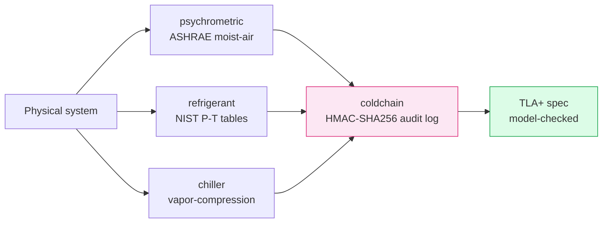

# carreir

> Physical-intelligence substrate for HVAC + cold-chain in Zig. HMAC-SHA256 chained cold-chain log with TLA+ formal spec model-checked by CI.

[](https://github.com/SMC17/carreir/actions)
[](LICENSE)
[](https://ziglang.org/)
[](#tests)
[](#)

A Zig physical-intelligence substrate for HVAC and cold-chain research.
Deterministic kernels for psychrometric calculations, refrigerant
saturation tables, and tamper-evident cold-chain logging.

> **Pre-1.0.** Zig itself is on 0.16; no production deployment exists.
> The substrate is genuinely usable for ASHRAE psychrometric
> calculations, NIST-style refrigerant lookups, and HMAC-chained
> cold-chain logging today — but it is not a replacement for
> EnergyPlus, TRNSYS, NIST REFPROP, or a certified compliance system.
> See [STATUS.md](STATUS.md) for proof levels per module.

## What ships

- `psychrometric/` — ASHRAE 2021 Ch.1 moist-air primitives (22 unit tests)
- `refrigerant/` — NIST-published saturation P-T for R-134a / R-410A / R-32 / R-1234yf / R-744 (21 unit tests)
- `coldchain/` — HMAC-SHA256 append-only reefer log with TLA+ formal spec model-checked in CI (10 unit tests + 200-500 trial property tests)
- `chiller/` — comptime safety invariants for vapor-compression cycles (1 unit test)

## What does NOT ship yet

- Not cross-validated against EnergyPlus / TRNSYS / OpenStudio
- Not differential-tested against NIST REFPROP as a library
- No production deployment, no soak time, no incident history
- No FDA/HACCP/EU-GDP certification (the log is compatible-shaped, not certified)
- No BMS/SCADA gateway, no service surface

## Architecture



## What it is

Three composable hulls under `src/`:

| Hull | Purpose | Reference | Proof level |
|---|---|---|---|
| `psychrometric/` | Moist-air primitives at standard pressure — saturation pressure, humidity ratio, enthalpy, dewpoint | ASHRAE Handbook — Fundamentals (2021), Ch.1 | `unit-tested` (22 cases) |
| `refrigerant/` | Saturation P-T tables + lookup for R-134a / R-410A / R-32 / R-1234yf / R-744 | NIST Webbook + REFPROP-published values | `unit-tested` (21 cases) |
| `coldchain/` | HMAC-SHA256 append-only reefer log with tamper detection + replay | TLA+ formal spec (`src/coldchain/Coldchain.tla`) model-checked in CI | `audit-logged` + `unit-tested` (10 cases) + `model-checked` |
| `chiller/` | Comptime safety invariants for vapor-compression chiller cycles (surge + slugging) | First-principles thermodynamics | `unit-tested` (1 case) |

current_test_count: 54

**Tests: 54/54 pass on Zig 0.16 / Linux x86_64** (`zig build test --summary all`).
A drift-check workflow fails CI if the declared count and the actual count diverge.

A TLA+ formal specification of the cold-chain log
(`src/coldchain/Coldchain.tla`) is model-checked on every push touching the
spec. Three invariants are pinned: `WriterLogIsAlwaysValid`,
`TamperDetection`, `ReorderingDetected`.

## What it is not — honest non-claims

- **Not cross-validated against EnergyPlus / TRNSYS / OpenStudio.**
  Psychrometric values are pinned to ASHRAE 2021 Ch.1 textbook examples;
  refrigerant values to NIST-published saturation points. Not yet
  differential-tested against a full HVAC simulator.
- **Not cross-checked against NIST REFPROP** as a library — only against
  published reference points.
- **No production deployment.** Zero real-traffic operation; zero soak
  time; zero production-incident history.
- **No certified regulatory compliance.** The cold-chain log is shaped
  to be compatible with FDA 21 CFR Part 11, HACCP, and EU GDP audit
  trails, but compatibility is not certification.
- **No real building-management-system (BMS) integration.** This is a
  set of in-process Zig libraries with a small CLI shell — not a
  service, not a gateway, not a SCADA adapter.

## Quickstart

Requires Zig 0.16.0.

```sh
zig build test --summary all   # 54/54 pass

# CLI examples:
zig build run -- psychro 30 20                       # moist-air state for T_db=30°C, T_wb=20°C
zig build run -- refrigerant R-410A T=5              # saturation pressure of R-410A at 5°C
zig build run -- refrigerant R-134a P=400            # saturation temperature of R-134a at 400 kPa
zig build run -- coldchain replay /path/to/log.ccl   # verify HMAC chain on a reefer log
```

## Cold-chain log — design summary

`src/coldchain/log.zig` (489 LOC) is the most-developed primitive.

Each on-disk entry is fixed-width 88 bytes:

```
timestamp_us   u64 LE    8
temperature_c  f32 LE    4
humidity       f32 LE    4
accel_x_mg     i16 LE    2
accel_y_mg     i16 LE    2
accel_z_mg     i16 LE    2
reserved       [2]u8     2
prior_hmac     [32]u8   32
hmac           [32]u8   32
                        88
```

The HMAC over each entry is `HMAC-SHA256(key, prior_hmac || payload)`.
Coupling each signature to the entire prefix means removing, reordering,
or inserting any entry breaks the chain.

Threat model: an adversary can modify any byte of the stored log but
does not have the HMAC key. `verifyChain` and `replay` reject
single-bit tampering, entry swaps, deletions, and insertions.

Property-based tests (200–500 randomised trials per property) pin:
- Random N-entry chain (N in [1, 100]) always appends and verifies.
- Any single-bit flip in any byte is detected.
- `appendOne(key, prior_hmac, sample)` is deterministic.
- Verification with the wrong key always rejects.

The same invariants are encoded as a TLA+ specification
(`src/coldchain/Coldchain.tla`) and model-checked by CI on every push
that touches the spec.

## Engineering posture

- Zig 0.16 first; deterministic kernels.
- AGPL-3.0 (integrators wrap for commercial; the substrate stays sovereign).
- First-principles thermodynamics — no vendor SCADA coupling.
- Pre-1.0 versioning; v1.0 only when both (a) Zig itself hits 1.0 and
  (b) a real production deployment exists.

## Companion lanes

The physical-substrate trio (Quant Mercantilism made physical):

- **[steam](https://github.com/SMC17/steam)** — NYISO energy market research engine. Bronze→silver→gold→graph + district-thermal modeling.
- **[oceanman](https://github.com/SMC17/oceanman)** — submarine-cable knowledge base + analysis methodology. 693 cables, H3 spatial index.

## Non-claims

- Not a substitute for EnergyPlus / TRNSYS / OpenStudio / NIST REFPROP as a library.
- Not a certified compliance system.
- Not a SCADA adapter or BMS gateway.
- The `v1.0.0` git tag predates the Zig-1.0 + production-deployment gate; treat as pre-1.0 substrate per [STATUS.md](STATUS.md).

## License

AGPL-3.0. See [LICENSE](LICENSE).

## Contributing

See [CONTRIBUTING.md](CONTRIBUTING.md). Security disclosure:
[SECURITY.md](SECURITY.md). Project state and per-module proof
levels: [STATUS.md](STATUS.md).
